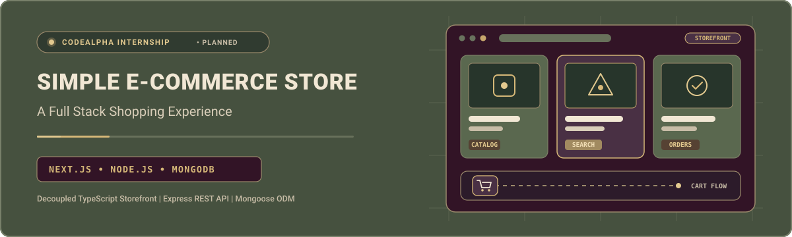

# Simple E-commerce Store



[](LICENSE)
[](#codealpha-internship-context)
[](#development-roadmap)

A planned full-stack e-commerce web application built for the **CodeAlpha Full Stack Development Internship**, featuring a completed **Next.js + TypeScript + Tailwind CSS** storefront (`simple.`, White Canvas Commerce v2 UI) with static demo catalog data and browser `localStorage` persistence, alongside a planned Express.js REST API and MongoDB Atlas backend.

> **Current Stage:** Phases 1–4 (`M1`–`M5`) are complete — the responsive Next.js storefront (`frontend/`) and UI/UX documentation (`docs/`) are implemented and verified. Backend REST API (`Express.js`), MongoDB Atlas integration (`Mongoose`), server-side JWT authentication, and live deployment remain **Planned** for Phases 5–8.

---

## CodeAlpha Internship Context

| Field | Details |
| --- | --- |
| **Internship** | CodeAlpha Full Stack Development Internship |
| **Project Name** | Simple E-commerce Store |
| **Repository** | [`CodeAlpha_EcommerceStore`](https://github.com/mddanish-31/CodeAlpha_EcommerceStore) |
| **Author** | MD DANISH RAZA ([@mddanish-31](https://github.com/mddanish-31)) |

---

## Project Overview

**Simple E-commerce Store** aims to deliver a clean, responsive online shopping workflow—product discovery, search and category filtering, cart management, user authentication, and order tracking—backed by a structured REST API and cloud database.

### Implemented vs. Planned Status

| Area | Current Status | Notes |
| --- | --- | --- |
| GitHub Repository & MIT License | **Implemented** | Public repository on `main` branch with `LICENSE` |
| Secret & Artifact Exclusions (`.gitignore`) | **Implemented** | Excludes `.env`, `.env.*`, keys, `node_modules/`, and build outputs |
| UI/UX Design Specs & Preview (`docs/`) | **Implemented** | [Design System v2](docs/design-system-v2.md), [UX Blueprint v2](docs/frontend-ux-blueprint-v2.md), [Component Architecture](docs/frontend-component-architecture.md), and [Responsive Spec](docs/responsive-design-spec.md) |
| Frontend Storefront (`Next.js` + `TypeScript` + `Tailwind CSS`) | **Implemented (Demo State)** | `11` App Router routes with static catalog (`12` products) and `localStorage` cart/demo-order/demo-auth state; no backend API connected yet |
| Backend REST API (`Node.js` + `Express.js` + `JWT`) | **Planned** | Not yet scaffolded (Phase 5) |
| Database Integration (`MongoDB Atlas` + `Mongoose`) | **Planned** | Not yet configured (Phase 6) |
| Full-Stack Integration QA & Deployment | **Planned** | Not yet executed (Phases 7–8) |

---

## Problem Statement & Objectives

### Problem Statement
Small retail storefronts often rely on either rigid templates or overly complex platforms when they need a maintainable, responsive storefront with straightforward catalog browsing, cart state, user accounts, and order persistence.

### Objectives
- Design a responsive, accessible storefront UI using Next.js, TypeScript, and Tailwind CSS.
- Implement a modular Express.js REST API with input validation and centralized error handling.
- Persist users, products, carts, and orders reliably in MongoDB Atlas via Mongoose.
- Maintain strict repository hygiene with no committed secrets, keys, or build artifacts.
- Deliver a verified, tested, and deployed full-stack application for CodeAlpha evaluation.

---

## Features & Current Scope

### Implemented in Frontend (`localStorage` Demo Storefront)
- **White Canvas Constellation Storefront (`/`):** 8-tile asymmetric product constellation hero, centered `<search>` pill bar, department pills, Slate Ink spotlight panel, interactive showcase preview, curated bestsellers grid, and demo newsletter form.
- **Product Catalog & Filtering (`/shop` & `/shop/[id]`):** `12` curated demo objects across `4` departments with keyword search, department/sort/in-stock URL query sync, mobile `FilterDrawer`, stock guard on sold-out items, and multi-stage SVG product galleries.
- **Shopping Bag & Simulated Checkout (`/cart` & `/checkout`):** Slide-over `<dialog closedby="any">` `CartDrawer`, `$75` free-shipping progress bar, client validation, and simulated `ORD-2026-XXXX` order generation persisted locally in browser storage.
- **Demo Account & Utility Views (`/auth/login`, `/auth/register`, `/account`, `/about`, `/contact`, `404`):** Simulated sign-in with demo credentials helper, local order history display, craft story, and client-validated contact inquiry form.

### Planned Full-Stack Scope (Not Yet Implemented)
- **Live Backend REST API:** Express.js routes for catalog CRUD, server-side cart/order persistence, and input validation.
- **Database Persistence:** MongoDB Atlas clusters and Mongoose schemas for Users, Products, Carts, and Orders.
- **Real Authentication & Authorization:** Password hashing and signed JWT verification middleware.
- **Production Payments & Live Deployment:** External payment gateway integration and hosted deployment remain outside the current static demo scope.

---

## Technology Stack

| Layer | Technology | Status |
| --- | --- | --- |
| **Frontend Framework** | Next.js (`16.4.5`) | Implemented (static/client demo storefront) |
| **Language** | TypeScript (`5.9.3`) | Implemented in `frontend/` |
| **Styling** | Tailwind CSS (`3.4.19`) | Implemented (White Canvas Commerce v2 tokens) |
| **Backend Runtime & Framework** | Node.js + Express.js | Planned (Phase 5) |
| **Database & ODM** | MongoDB Atlas + Mongoose | Planned (Phase 6) |
| **Authentication** | JSON Web Tokens (JWT) | Planned (Phase 5) |
| **Version Control** | Git & GitHub | Implemented (`main` branch) |

---

## High-Level Architecture *(Planned)*

The system is planned as a decoupled client–server architecture separating the Next.js storefront from the Express.js API and MongoDB Atlas database:

```text
+-----------------------------------+
|        Client Browser             |
|   Next.js + TypeScript + Tailwind |
+-----------------+-----------------+
                  |  HTTPS / JSON (Planned REST API)
                  v
+-----------------------------------+
|      Backend Application          |
|    Node.js + Express.js Server    |
|  (Auth, Validation, Controllers)  |
+-----------------+-----------------+
                  |  Mongoose ODM (Planned)
                  v
+-----------------------------------+
|      MongoDB Atlas Cluster        |
|  (Users, Products, Carts, Orders) |
+-----------------------------------+
```

### Conceptual Database Entities *(Planned)*
- **Users:** User identity, hashed credentials, role, and timestamps.
- **Products:** Title, description, category, price, stock count, and media references.
- **Carts:** User reference, line items (product reference and quantity), and update timestamps.
- **Orders:** User reference, ordered item snapshots, total amount, status, and timestamps.

*REST API endpoint contracts (`T-016`) and final Mongoose schemas remain **Pending** until backend and database design in Phases 5–6.*

---

## Repository Structure

### Current Verified Repository Structure
```text
CodeAlpha_EcommerceStore/
├── assets/
│   └── ecommerce-banner.svg                 # Animated SVG repository hero banner
├── docs/
│   ├── design-system-v2.md                  # Authoritative White Canvas Commerce design tokens
│   ├── design-reference-mapping-v2.md       # Visual hierarchy & component mapping
│   ├── frontend-ux-blueprint-v2.md          # Route & UX preservation blueprint
│   ├── frontend-component-architecture.md   # Next.js components & client contracts
│   ├── responsive-design-spec.md            # Viewport breakpoints & QA matrix summary
│   ├── preview/shop-constellation-preview.html
│   └── qa/                                  # Verified desktop & mobile QA screenshots
├── frontend/                                # Implemented Next.js 16 + TypeScript storefront
├── .gitignore                               # Excludes node_modules, .env*, keys, logs, and build artifacts
├── LICENSE                                  # MIT License
└── README.md                                # Project documentation
```

*`backend/` remains planned for Phase 5 initialization.*

---

## Development Roadmap

| Phase | Milestone | Status |
| --- | --- | --- |
| **Phase 1** | Project Tracker Setup (`M1`) | **Complete** |
| **Phase 2** | GitHub Repository Audit & Setup (`M2`) | **Complete** |
| **Phase 3** | Project Documentation (`M3`) | **Complete** |
| **Phase 4** | Frontend UI/UX Design & Implementation (`M4`, `M5`) | **Complete** |
| **Phase 5** | Backend Architecture & REST API Development (`M6`, `M7`) | **Pending** |
| **Phase 6** | MongoDB Atlas & Mongoose Integration (`M8`) | **Pending** |
| **Phase 7** | Testing, Security Checks & UI Polish (`M9`–`M11`) | **Pending** |
| **Phase 8** | Deployment, Final README Update & Submission (`M12`) | **Pending** |

---

## Running the Frontend Locally

Only the Next.js storefront (`frontend/`) exists today; backend API setup remains pending Phase 5.

```bash
git clone https://github.com/mddanish-31/CodeAlpha_EcommerceStore.git
cd CodeAlpha_EcommerceStore/frontend
npm install
npm run dev
```

Verified frontend scripts defined in [`frontend/package.json`](frontend/package.json):
- `npm run dev` — start the Next.js development server (`http://localhost:3000`)
- `npm run build` — create the production static/SSG build
- `npm run typecheck` — run TypeScript type checking (`tsc --noEmit`)
- `npm run lint` — run configured check script (`tsc --noEmit`)

### Planned Backend & Full-Stack Setup *(Pending Phases 5–6)*
1. Scaffold Express.js server in `backend/` and configure local environment variables.
2. Connect MongoDB Atlas via Mongoose and replace `frontend/src/data/products.ts` / `localStorage` demo flows with REST API calls.

---

## Environment Configuration *(Planned)*

No `.env` files or secrets exist in the repository. `.gitignore` already excludes `.env`, `.env.*` (except `.env.example`), `*.pem`, and `*.key`.

Planned environment variable names *(subject to Phase 5–6 implementation)*:

| Variable Name | Layer | Planned Purpose |
| --- | --- | --- |
| `PORT` | Backend | HTTP port for the Express server |
| `MONGODB_URI` | Backend | MongoDB Atlas connection string |
| `JWT_SECRET` | Backend | Secret key for signing and verifying JWT tokens |
| `NEXT_PUBLIC_API_URL` | Frontend | Base URL for backend REST API requests |

Never commit real credentials, database URIs, or secret keys to version control.

---

## Testing Strategy *(Planned)*

Phase 7 quality assurance is planned to cover:
- **Functional Testing:** End-to-end verification of catalog browsing, search/filtering, cart updates, authentication, checkout, and order history.
- **Responsive Testing:** Layout and interaction checks across mobile, tablet, and desktop breakpoints.
- **Integration Testing:** Verification of request validation, HTTP status handling, and MongoDB Atlas CRUD persistence.
- **Defect Tracking:** Logging and verifying bug fixes in the project tracker prior to deployment.

---

## Security Considerations

- **Repository Hygiene (Implemented):** `.gitignore` blocks `.env`, `.env.*`, `*.pem`, and `*.key` from being committed.
- **Application Controls (Planned):**
  - Password hashing prior to database persistence.
  - Route protection via JWT verification middleware.
  - Server-side input validation and sanitization on API requests.
  - Restricted CORS configuration and centralized error handling without secret or stack-trace leaks.

---

## Deployment Plan *(Planned)*

No live deployment exists yet. After Phase 7 verification passes, Phase 8 plans to:
1. Configure production environment variables for the Next.js frontend, Express.js backend, and MongoDB Atlas cluster.
2. Deploy both services and verify end-to-end storefront, auth, and order workflows in production.
3. Update `README.md` (`T-046`) with verified live URLs and final setup notes.

---

## Contribution Guidelines

This repository is developed primarily as an individual CodeAlpha internship project. To propose improvements:
1. Fork the repository.
2. Create a focused branch from `main`.
3. Verify no `.env` files, credentials, or unrelated edits are included.
4. Open a pull request describing the change.

---

## Author & Internship Attribution

- **Developer:** MD DANISH RAZA
- **GitHub:** [@mddanish-31](https://github.com/mddanish-31)
- **Internship:** CodeAlpha Full Stack Development Internship

---

## License

This project is licensed under the **MIT License** — see [LICENSE](LICENSE) for full text.
Copyright (c) 2026 MD DANISH RAZA.
