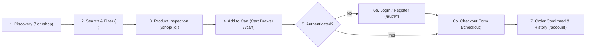

# Frontend UX Blueprint — Simple E-commerce Store

**Project:** Simple E-commerce Store (`CodeAlpha_EcommerceStore`)  
**Internship:** CodeAlpha Full Stack Development Internship  
**Target Stack:** Next.js (App Router) + TypeScript + Tailwind CSS *(Planned — Phase 4B)*  
**Design Authority:** [design-system.md](./design-system.md) & [design-reference-mapping.md](./design-reference-mapping.md)

> **Implementation Honesty Note:** All routes, UI flows, and data interactions below represent the **approved UX blueprint for Phase 4B implementation**. No frontend routes, backend REST APIs, authentication endpoints, or database schemas are claimed as implemented yet. Checkout does **not** integrate an external payment gateway.

---

## 1. Complete Route & Page Inventory

| # | Page / Surface | Planned Next.js Route | Access Level | Primary UX Purpose |
| :--- | :--- | :--- | :--- | :--- |
| **1** | **Homepage** | `/` | Public | Editorial brand arrival, featured categories, trending catalog, promotional spotlight, new arrivals, trust guarantees, and newsletter signup |
| **2** | **Shop / Product Listing** | `/shop` | Public | Full searchable, filterable, sortable product catalog grid with URL-synced query parameters |
| **3** | **Product Details (PDP)** | `/shop/[id]` | Public | Studio gallery, pricing/discount, live stock status, quantity stepper, Add to Cart, specification accordions, and related products |
| **4** | **Shopping Cart (Drawer & Page)** | `/cart` + Global `<dialog>` Drawer | Public | Line-item review, quantity adjustment, item removal, subtotal/shipping calculation, and checkout launch |
| **5** | **Checkout** | `/checkout` | Authenticated *(or Guest-to-Auth prompt)* | Customer contact details, shipping address form, order summary review, and order placement confirmation (no external payment gateway) |
| **6** | **Login** | `/auth/login` | Public (Guest) | Customer sign-in with email/password validation, password visibility toggle, and redirect-back support |
| **7** | **Register** | `/auth/register` | Public (Guest) | New customer account creation with inline field validation and password strength guidance |
| **8** | **Customer Account & Orders** | `/account` | Protected (JWT) | Profile overview, saved personal details, order history table/cards, and expandable order item breakdowns |
| **9** | **About** | `/about` | Public | Storefront craft ethos, internship project context, and quality standards |
| **10** | **Contact** | `/contact` | Public | Customer support inquiry form (pill inputs + surface textarea), support hours, and FAQ `
` accordion |
| **11** | **404 Not Found** | `/not-found.tsx` | Public | Oversized `404` Tiger Gold poster headline with instant search and Ghost/Primary links back to `/shop` |
| **12** | **Mobile Navigation & Filter Drawers** | Global `<dialog closedby="any">` | Public | Slide-over mobile navigation menu and catalog filter sheet with automatic focus trapping and light-dismiss |

---

## 2. End-to-End Customer Shopping Journey

1. **Arrival & Discovery:** User lands on `/` (Homepage), scans the poster-scale hero or clicks a category pill (`Audio & Desk`, `Everyday Carry`, `Home Objects`, `Apparel`), or searches directly in the sticky header `<search>` landmark.
2. **Catalog Narrowing:** On `/shop`, user filters by category pill, sets a price ceiling, or sorts (`Featured`, `Price: Low → High`, `Price: High → Low`, `Newest`). Active filters appear as removable Tiger Gold pills with a `Clear All` action.
3. **Evaluation:** User clicks a product card to open `/shop/[id]` (PDP) or triggers `Quick Add` directly from the grid card. On PDP, user inspects thumbnails, verifies stock badge (`IN STOCK` vs `ONLY 3 LEFT`), adjusts quantity (`1–10`), and reads collapsible `
` tabs (`Specifications`, `Materials & Care`, `Shipping & Returns`).
4. **Cart Review:** Clicking `ADD TO CART` updates the header cart badge and opens the slide-over `<dialog id="cart-drawer" closedby="any">` (or `/cart` full page), showing item thumbnails, unit prices, quantity steppers, and live subtotal.
5. **Checkout & Order Persistence:** Clicking `PROCEED TO CHECKOUT` routes to `/checkout` (prompting `/auth/login` if required by backend order protection). User enters delivery address, reviews the itemized order summary, and clicks `PLACE ORDER`.
6. **Post-Purchase Tracking:** Upon order creation, `/checkout` renders the Order Confirmation state with order reference ID and links directly to `/account` where the order appears in **Order History**.

---

## 3. Page-by-Page Section Structure

### 3.1 Homepage (`/`)

Separated into 10 distinct bands divided by full-width `1px dotted #FAAE33` rules on the `#823513` Ember Rust canvas:

1. **Announcement Strip (`#281006` Charred Clove):** Compact `11px` uppercase bar: *"CODEALPHA FULL STACK E-COMMERCE STORE • FREE STANDARD SHIPPING ON ORDERS OVER $75"*.
2. **Sticky Header Bar (`#402011` Dark Spice):**
   - Left: Brand Wordmark (`ATELIER // STORE` in `Antonio` `24px` bold `#FAAE33` + circular emblem).
   - Center (Desktop): Ghost Outline Pill links (`SHOP`, `CATEGORIES`, `NEW ARRIVALS`, `ABOUT`, `CONTACT`).
   - Right: Semantic `<search>` pill input, Account pill button (`SIGN IN` / `ACCOUNT`), and Circular Cart Icon Button (`#FAAE33` `1.5px` bag icon + `#FAAE33` count pill). Mobile (`< 1024px`) displays a `44px × 44px` circular Menu button (`☰`) alongside Search and Cart.
3. **Editorial Hero Section (`#823513` Ember Rust + SVG Botanical/Geometric Watermark):**
   - **Left Column (60% width):** Eyebrow pill badge (`CURATED EVERYDAY OBJECTS — EDITION 01`), massive display headline (`CRAFTED FOR DAILY RITUALS` at `clamp(3.5rem, 9.5vw, 11.5rem)`, `0.82` line-height, `-0.02em` tracking in `#FAAE33`), concise `15px` `#FDF6EC` lead copy, and action row (`SHOP COLLECTION` Filled Primary Button + `EXPLORE CATEGORIES` Ghost Outline Button).
   - **Right Column (40% width):** Studio-lit featured product showcase on a recessed `#281006` / `#402011` pedestal with floating price/spec callout pill (`CHRONO DESK LAMP — $128`).
4. **Featured Categories Strip:**
   - Section header (`BROWSE BY DEPARTMENT` in `65px` `Antonio` `#FAAE33`) + 4 interactive `6px`-radius `#402011` category cards (`01 / Audio & Desk`, `02 / Everyday Carry`, `03 / Home Objects`, `04 / Technical Goods`) with item counts and arrow icon buttons.
5. **Trending / Best-Selling Products Grid:**
   - Section header + filter pills (`All`, `Best Sellers`, `Top Rated`) + 4-column responsive grid of `6px`-radius `#402011` Product Cards.
6. **Editorial Promotional Split Banner:**
   - Asymmetric 2-column poster section (`#281006` Charred Clove panel framed by `1px dotted #FAAE33`): `101px` `Antonio` headline (`BUILT TO OUTLAST TRENDS`) on left, spotlighted limited-drop item with `#D1255C` `LIMITED EDITION` alert badge and `SHOP THE DROP` CTA on right.
7. **New Arrivals Carousel / Grid:**
   - 4 newly added catalog items with `NEW ARRIVAL` primary gold pill badges.
8. **Trust & Service Guarantees Band:**
   - 4-column grid of `#402011` cards with `1.5px` Tiger Gold line icons:
     1. *Fast Dispatch* (Tracked delivery on every order)
     2. *30-Day Returns* (Hassle-free exchange guarantee)
     3. *Verified Quality* (Inspected materials & build)
     4. *Secure Account & Order Tracking* (Protected customer history)
9. **Newsletter Capture Section:**
   - Poster headline (`JOIN THE DISPATCH`) + inline `<form>` with a Pill Input Field (`Enter your email address`, `autocomplete="email"`) and `SUBSCRIBE` Filled Primary Button.
10. **Complete Site Footer (`#281006` Charred Clove):**
    - 4 columns (Brand Summary & Internship Attribution, Shop Links, Customer Care Links, Technical Stack Badge Row) + bottom copyright bar and oversized watermarked wordmark.

---

### 3.2 Shop / Product Listing (`/shop`)

1. **Catalog Hero Header:** Compact `65px` `Antonio` title (`ALL PRODUCTS`), live result counter (`Showing 12 of 24 items`), and breadcrumb (`Home / Shop`).
2. **Search & Control Bar (`<search>` Landmark):**
   - Keyword Pill Input (`Search by product name or category...`) with clear (`×`) button.
   - Horizontal scrollable Category Pill Bar (`All`, `Audio & Desk`, `Everyday Carry`, `Home Objects`, `Apparel`).
   - Price Filter control (`All Prices`, `Under $50`, `$50 – $150`, `$150+`) and Sort Pill Select (`Featured`, `Price: Low to High`, `Price: High to Low`, `Newest`).
   - On mobile (`< 768px`), Category and Price filters collapse into a `FILTERS (2)` Ghost Outline Pill button that opens the `<dialog id="filter-drawer" closedby="any">`.
3. **Active Filter Chips Row:** Displays applied filters as `#402011` pills with `×` remove buttons and a `Reset All` link.
4. **Product Grid:** 4 columns on desktop (`>= 1024px`), 2–3 on tablet, 1–2 on mobile. Each `6px`-radius `#402011` card includes:
   - `#281006` square/4:3 image well with SVG/studio illustration.
   - Status Badge (`BESTSELLER` in `#FAAE33`, `LOW STOCK` or `-15%` in `#D1255C`, or `OUT OF STOCK` in muted `#6B2E12`).
   - Category caption (`11px` uppercase `#E5C7A3`).
   - Product Title (`Antonio` `22px` `#FDF6EC`, linked to `/shop/[id]`).
   - Price (`18px` bold `#FAAE33` + optional strikethrough original price in `#E5C7A3`) + `ADD TO CART` Filled Primary Pill button (disabled with `SOLD OUT` label when stock is `0`).
5. **Pagination / Load More Bar:** Pill button row (`Previous`, page numbers `1`, `2`, `3`, `Next`).

---

### 3.3 Product Details (`/shop/[id]`)

1. **Breadcrumb Bar:** `Home / Shop / [Category] / [Product Title]` in `13px` `#E5C7A3` with `#FAAE33` hover.
2. **2-Column Primary Split (`55%` Gallery / `45%` Buy Box on Desktop):**
   - **Left — Product Image Gallery:**
     - Main stage (`6px` radius, `#281006` background, `1px solid #6B2E12` border) with subtle Tiger Gold radial spotlight and badge overlay.
     - Thumbnail strip below (`4` selectable `6px`-radius `#402011` thumbnail buttons with `2px solid #FAAE33` active border).
   - **Right — Product Buy Box:**
     - Category pill badge + SKU meta (`SKU: AT-014`).
     - Product Title (`Antonio` `clamp(2.25rem, 4vw, 3.75rem)`, `0.92` line-height, `#FDF6EC`).
     - Price Row (`28px` bold `#FAAE33`, strikethrough compare-at price, and `#D1255C` discount pill if on sale).
     - Availability Indicator: Pill badge showing green-free warm gold dot `● IN STOCK (14 AVAILABLE)` or `#D1255C` `● LOW STOCK (ONLY 2 LEFT)`.
     - Concise product description (`15px` `#FDF6EC`, `1.5` line-height, max `60ch`).
     - Action Bar: Pill Quantity Stepper (`−` / `1` / `+`) + full-width `ADD TO CART — $128.00` Filled Primary Button.
     - Exclusive Accordion Specs (`
` so opening one closes the others):
       1. `Specifications & Dimensions` (open by default)
       2. `Materials & Care`
       3. `Shipping & Return Policy`
3. **Dotted Divider (`1px dotted #FAAE33`) + Related Products Section:**
   - `YOU MAY ALSO LIKE` (`65px` `Antonio` `#FAAE33`) + 4-column grid of related products from the same category.

---

### 3.4 Shopping Cart (`<dialog>` Drawer & `/cart` Page)

1. **Header:** `YOUR CART (3 ITEMS)` (`Antonio` `29px` `#FAAE33`) + circular close button (`×`, `40px × 40px`).
2. **Free Shipping Progress Bar:** `#281006` pill track with `#FAAE33` fill bar (*"You're $12.00 away from FREE shipping"* or *"Unlocked: Free Standard Shipping"*).
3. **Cart Line Items List:** Each row is a `6px`-radius `#402011` card (`1px solid #6B2E12`) containing:
   - `64px × 64px` `#281006` thumbnail.
   - Title, category label, and unit price (`$64.00`).
   - Compact Pill Quantity Stepper (`−` `1` `+`) and `Remove` Ghost Borderless button (`aria-label="Remove [Product] from cart"`).
   - Line item subtotal (`tabular-nums`, `#FAAE33`).
4. **Order Summary Footer (`#281006` Charred Clove):**
   - Subtotal, Estimated Shipping (`FREE` or `$8.00`), Discount (if applicable), and `1px dotted #FAAE33` divider.
   - **Order Total** (`24px` bold `#FAAE33`).
   - Primary CTA: `PROCEED TO CHECKOUT` (Filled Primary Button, full width) + Secondary CTA: `CONTINUE SHOPPING` (Ghost Outline Button).

---

### 3.5 Checkout (`/checkout`)

> **Scope Rule:** Checkout collects customer contact information and shipping address to create a persisted order record. It does **not** invent a third-party payment gateway (e.g., Stripe/PayPal/Razorpay) or request credit card numbers.

1. **Checkout Progress Stepper:** `01 Cart` → `02 Delivery Details` → `03 Order Review & Confirmation`.
2. **2-Column Layout (`60%` Form / `40%` Sticky Order Summary on Desktop):**
   - **Left Column (`#402011` Card Containers):**
     - *Section 1 — Customer Contact:* Full Name (`autocomplete="name"`), Email Address (`autocomplete="email"`), Phone Number (`autocomplete="tel"`).
     - *Section 2 — Delivery Address:* Street Address (`autocomplete="street-address"`), Apartment/Suite, City (`autocomplete="address-level2"`), State/Province (`autocomplete="address-level1"`), Postal Code (`autocomplete="postal-code"`), Country (`autocomplete="country-name"`), and Delivery Notes (`<textarea>`).
     - *Section 3 — Settlement Method Notice:* Transparent informational banner stating *"Order Placement Mode (CodeAlpha Internship Demo): Orders are recorded directly to your account history upon submission; no live payment card is charged."*
   - **Right Column (`#281006` Order Summary Card):**
     - Itemized thumbnail list with quantities, Subtotal, Shipping, Total (`#FAAE33`), and `PLACE ORDER` Filled Primary Button.

---

### 3.6 Authentication (`/auth/login` & `/auth/register`)

Centered single-column card (`max-width: 480px`, `6px` radius, `#402011` fill, `1px solid #FAAE33` top accent border) on the `#823513` canvas:
- **Login (`/auth/login`):**
  - Header: `WELCOME BACK` (`65px` `Antonio` `#FAAE33`).
  - Fields: Email (`type="email"`, `autocomplete="username"`) and Password (`type="password"`, `autocomplete="current-password"`) with circular `Show/Hide` toggle button (`aria-pressed`).
  - Actions: `SIGN IN` Filled Primary Button + Ghost link *"New customer? Create an account"*.
- **Register (`/auth/register`):**
  - Header: `CREATE ACCOUNT` (`65px` `Antonio` `#FAAE33`).
  - Fields: Full Name (`autocomplete="name"`), Email (`autocomplete="email"`), Password (`autocomplete="new-password"`, minimum length helper caption), Confirm Password.
  - Actions: `CREATE ACCOUNT` Filled Primary Button + Ghost link *"Already have an account? Sign in"*.

---

### 3.7 Customer Account (`/account`)

1. **Account Header:** Customer greeting (`HELLO, DANISH RAZA`), Role pill badge (`CUSTOMER`), and `SIGN OUT` Ghost Outline Button.
2. **Account Navigation Pills:** `Overview`, `Order History`, `Personal Info`.
3. **Personal Information Card (`#402011`):** Displays registered name, email, joined date, and default delivery address.
4. **Order History List:**
   - Each order is a `6px`-radius `#402011` card with header bar (`ORDER #ORD-2026-0104`, Date, Status Pill Badge [`PROCESSING` / `SHIPPED` / `DELIVERED` in `#FAAE33` or `CANCELLED` in `#D1255C`], Total Amount) and an expandable `
` section showing the snapshot of ordered items and shipping address.

---

### 3.8 Additional Pages (`/about`, `/contact`, `404`)

- **About (`/about`):** Editorial poster layout explaining the **Simple E-commerce Store** craft curation concept, the **CodeAlpha Full Stack Development Internship** architecture (Next.js + Express.js + MongoDB Atlas), and design principles.
- **Contact (`/contact`):** 2-column layout with support channels on the left and a validated inquiry form (Name, Email, Order ID optional, Message `<textarea>`, `SEND MESSAGE` button) + FAQ `
` accordion on the right.
- **404 (`/not-found.tsx`):** `195px` `Antonio` `404` display numeral in `#FAAE33`, subtitle `PAGE LOST IN THE BAZAAR`, `<search>` bar, and `RETURN TO SHOP` Filled Primary Button.

---

## 4. Interactive States Matrix (Loading, Empty, Error & Success)

Every data-driven view must implement all four non-happy-path states using the approved palette:

| Surface / Flow | Loading State | Empty State | Error State | Success State |
| :--- | :--- | :--- | :--- | :--- |
| **Shop Grid (`/shop`)** | 8 skeleton cards (`#402011` with subtle `#6B2E12` pulse shimmer; disabled under `prefers-reduced-motion`) | `#402011` panel with `1.5px` search icon: *"No products match '[query]'"* + `RESET FILTERS` Filled Primary Button | `#281006` card with `1px solid #D1255C` border + `#D1255C` alert pill: *"Unable to load catalog"* + `RETRY` button | Live aria-live polite count update (`"Showing 8 products"`) |
| **Product Details (`/shop/[id]`)** | Gallery + Buy Box skeleton blocks | `404 Product Not Found` card with `BROWSE ALL PRODUCTS` CTA | Inline `#D1255C` alert banner if product fetch fails + `RETRY` button | `ADD TO CART` button flashes `✓ ADDED TO CART` (`800ms`) and opens Cart Drawer |
| **Shopping Cart** | Line-item opacity `0.6` + disabled stepper during quantity update | Centered `#281006` empty state: `1.5px` bag icon, *"YOUR CART IS EMPTY"*, and `EXPLORE CATALOG` Filled Primary Button | Inline `#D1255C` pill if requested quantity exceeds stock (`"Max available stock reached"`) | Free shipping progress bar fills to `100%` `#FAAE33` with unlocked badge |
| **Checkout (`/checkout`)** | `PLACE ORDER` button shows spinner + `"PLACING ORDER..."` (`aria-busy="true"`) | Redirects to `/shop` with notice if cart is empty | Field-level `#D1255C` borders + `role="alert"` summary banner at top of form | Full Order Confirmation card with Order ID (`#ORD-...`) and `VIEW IN ACCOUNT` CTA |
| **Auth (`/auth/*`)** | Submit button disabled with `"VERIFYING..."` label | N/A | `#D1255C` alert banner (`"Invalid email or password"`) with focus returned to first invalid input | Redirects to intended destination (`/checkout` or `/account`) with toast notice |
| **Account Orders (`/account`)** | 3 order row skeletons (`#402011`) | *"NO ORDERS YET — Your completed orders will appear here"* + `START SHOPPING` button | `#D1255C` banner (`"Could not load order history"`) + `RETRY` button | Expandable `
` reveals full item breakdown and delivery address |
